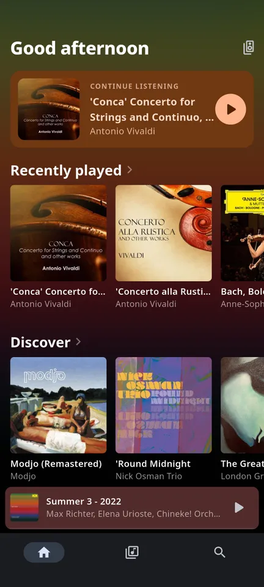
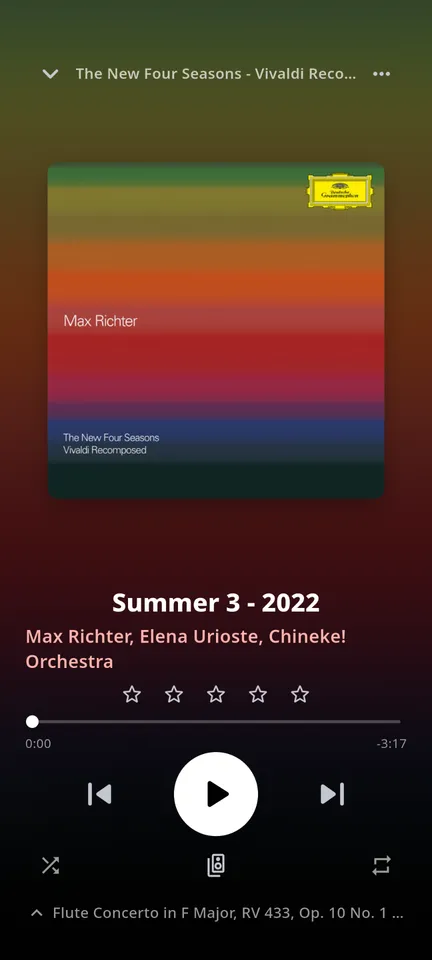
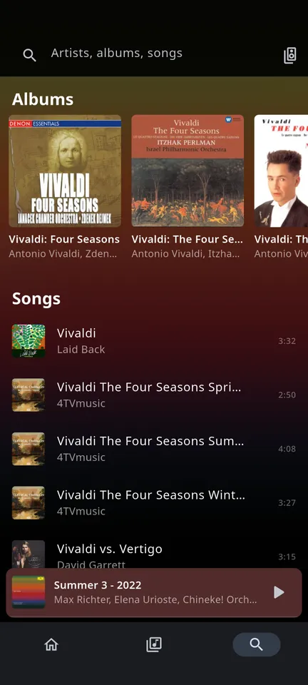
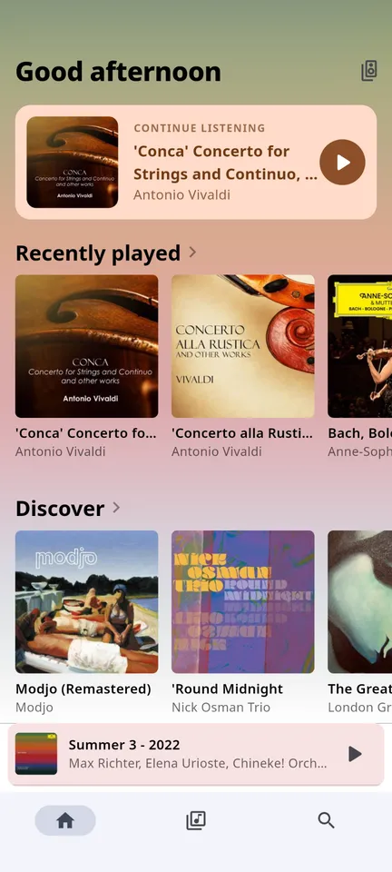
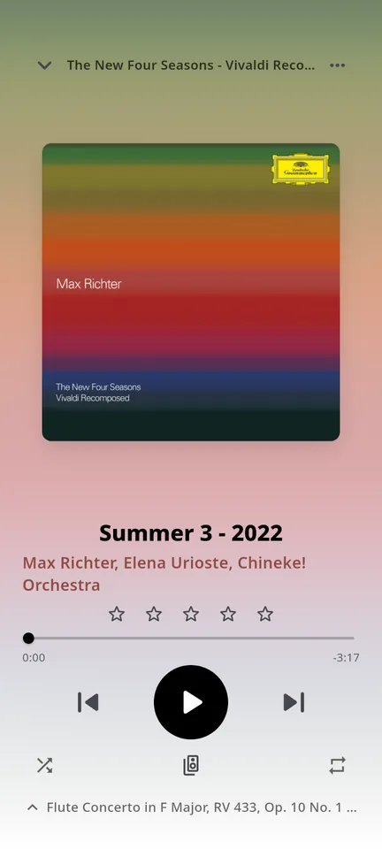
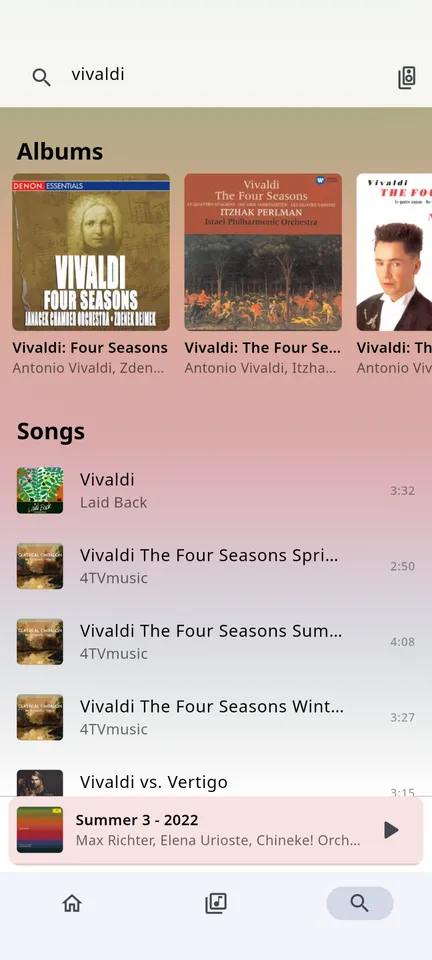
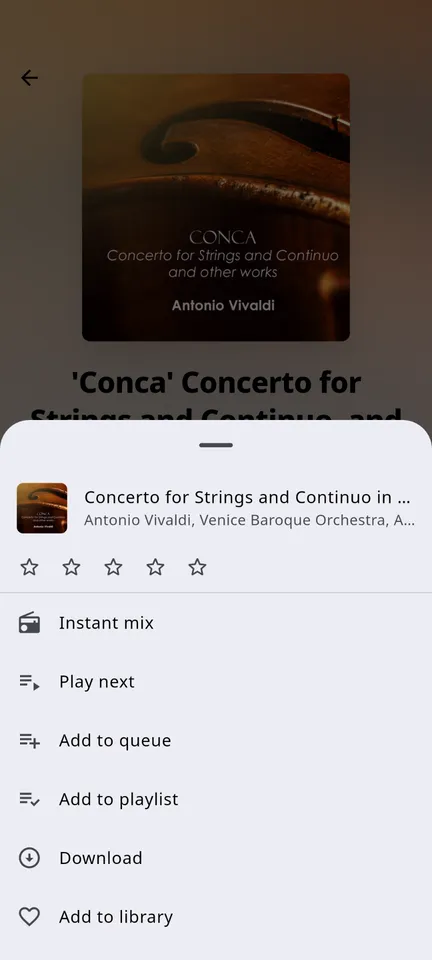

# Puffer

A music player for iOS and Android for Subsonic and OpenSubsonic servers (Navidrome, Gonic, Airsonic-Advanced, …).

- The interface follows Plexamp.
- Downloads follow Apple Music: a person downloads songs, albums, playlists or artists, downloaded playlists stay in sync, automatic downloads are optional, and the downloaded library can be browsed offline.
- Multi-room playback goes through [Music Assistant](https://music-assistant.io), which sends the audio to the speakers over [Sendspin](https://www.sendspin-audio.com).

The app is in early development.

| Home | Now playing | Recently played | Search | Track menu |
| --- | --- | --- | --- | --- |
|  |  |  |  |  |
|  |  |  |  |  |

## Install

- Android: APKs are on [GitHub Releases](https://github.com/anatosun/puffer/releases) and in the F-Droid repository at [anatosun.github.io/puffer/fdroid/repo](https://anatosun.github.io/puffer/fdroid/repo?fingerprint=BEF73814AF9AAA087C0D1E1585B92777674363B35CBE50D125C04846593D8ECF), signed with the key of fingerprint `BEF73814AF9AAA087C0D1E1585B92777674363B35CBE50D125C04846593D8ECF`.
- iOS: not yet published.

## Build

```sh
flutter pub get
dart run build_runner build --delete-conflicting-outputs
flutter run
```

## License

Puffer is free software under the [GNU General Public License v3.0 or later](LICENSE).
